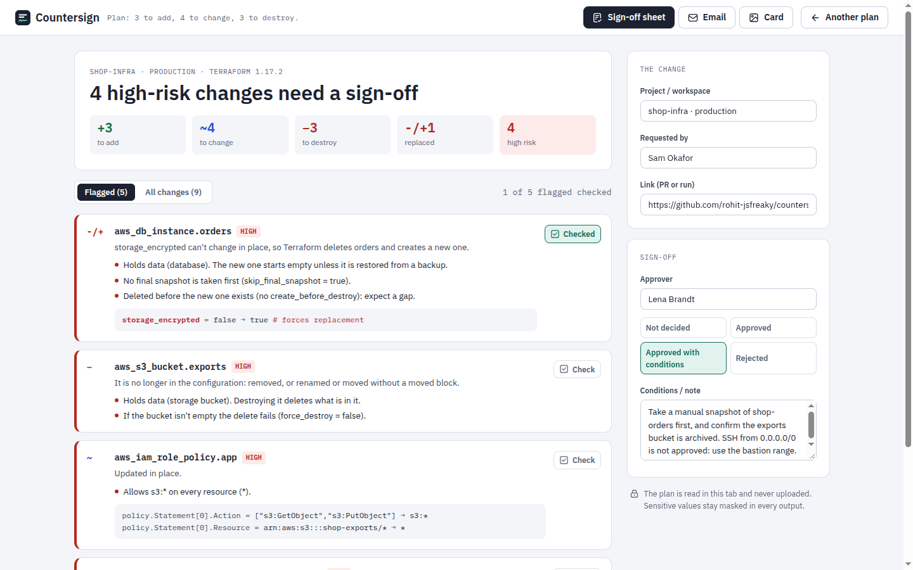
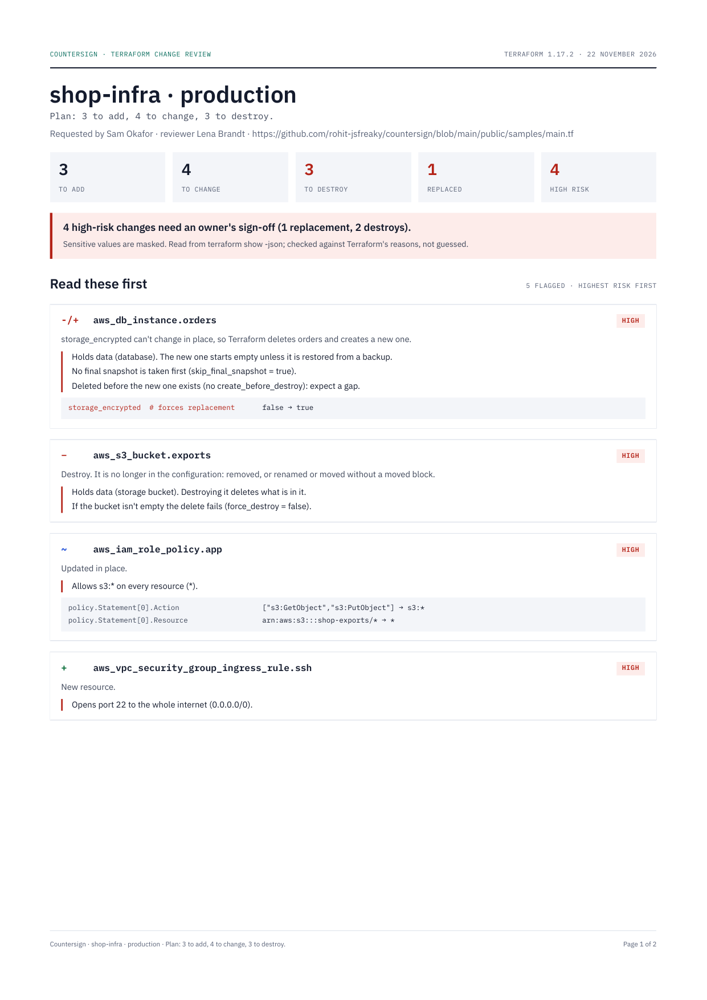
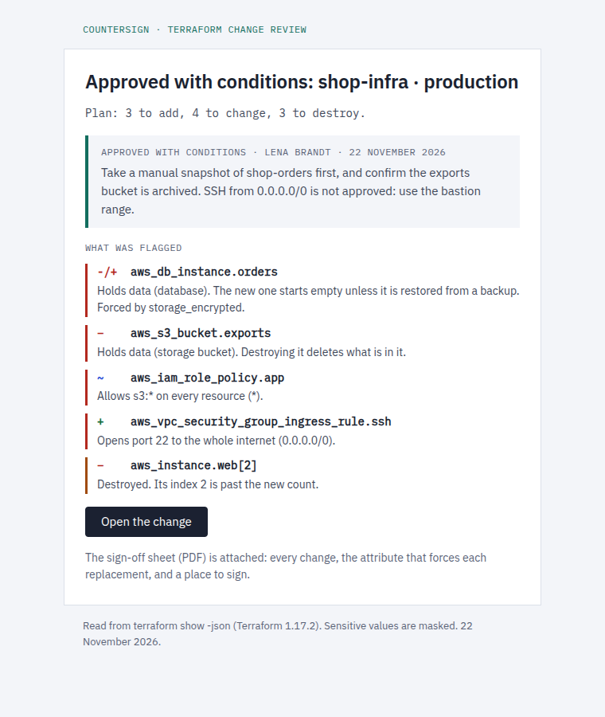
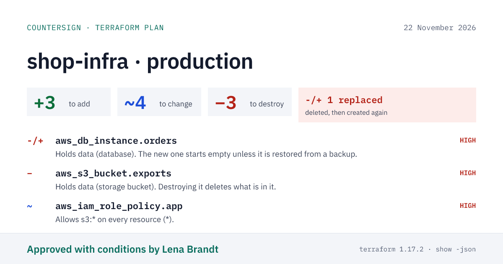

# Countersign

**See what the plan destroys before you sign it.** Drop in `terraform show -json`. Countersign ranks every change in a
Terraform plan by risk and puts the ones that need an owner's yes first: databases and buckets destroyed or replaced,
ports opened to the internet, wildcard IAM. Each comes with Terraform's own reason and the attribute that forces it.
Then it makes:

- a sign-off sheet (PDF): the risky changes first, every other change in one line, then the decision and a signature
- an email to the approver: what needs their eyes; after the decision, the decision and its conditions
- a plan card (PNG) for the pull request or the team channel: the counts, the riskiest changes, the sign-off state

It runs in the browser: a plan JSON holds secrets in plain text, so nothing is uploaded, and sensitive values show as
`(sensitive)` everywhere.

Built with [Hyper Elements](https://github.com/hyper-elements/hyper-elements) for the Hyper Elements Template Challenge.

**Live:** https://countersign.rohitkashyapmrt.workers.dev



## Why this exists

Teams already gate `terraform apply` behind a human approval. The human gets the raw plan. On r/Terraform
([Feb 2024](https://www.reddit.com/r/Terraform/comments/1b0a1gh/)), a platform team that posts every plan on the pull
request: "These devs don't know how to read the plan, and have caused a number of outages from accidentally deleting
mission critical resources." In "Do you block every Terraform plan that replaces a database?"
([Nov 2026](https://www.reddit.com/r/Terraform/comments/1y11q0b/)), the answer: "I'd block on replace with no explicit
ok … someone who owns that db signs off after seeing a fresh snapshot or backup exists." And
([Mar 2025](https://www.reddit.com/r/Terraform/comments/1ja5sz8/)): "We still have to manually approve Terraform plans.
Every. Single. Time."

Plan-comment tools post the plan as it is. Countersign is the triage and the record of who said yes.

**A real example.** The sample is a real plan made by Terraform 1.17.2 and the `hashicorp/aws` provider from
`public/samples/main.tf` (a sample stack and state; no AWS account). "Plan: 3 to add, 4 to change, 3 to destroy." The
line that matters for the database is line 62 of 183, inside a 52-line block of "known after apply":

| Change | Countersign says | Risk |
|---|---|---|
| `aws_db_instance.orders` replaced | `storage_encrypted` can't change in place: the database is deleted and created again, empty. No final snapshot (`skip_final_snapshot = true`). Deleted before the new one exists. | high |
| `aws_s3_bucket.exports` destroyed | Holds data. No longer in the configuration: removed, or renamed or moved without a moved block. | high |
| `aws_iam_role_policy.app` updated | Allows `s3:*` on every resource (`*`); it was GetObject and PutObject on one bucket. | high |
| `aws_vpc_security_group_ingress_rule.ssh` created | Opens port 22 to the whole internet (0.0.0.0/0). | high |
| `aws_instance.web[2]` destroyed | Its index 2 is past the new count. | medium |
| `aws_instance.web[0]`, `[1]` updated | `instance_type` t3.small → t3.medium: AWS stops and starts the instance. | low |

| Sign-off sheet, page 1 | Email | Card |
|---|---|---|
|  |  |  |

The landing page (7 sections with an FAQ): [media/landing.png](media/landing.png). On a phone:
[media/mobile.png](media/mobile.png) and [media/mobile-review.png](media/mobile-review.png). The sample sheet:
[public/landing/sign-off.pdf](public/landing/sign-off.pdf).

## How it works

| Step | What happens |
|---|---|
| **Save the plan as JSON** | `terraform plan -out=tfplan && terraform show -json tfplan > plan.json` (OpenTofu: `tofu show -json`). Drop the file in or paste it. |
| **Rank** | `templates/_shared/plan.ts` reads HashiCorp's [JSON output format](https://developer.hashicorp.com/terraform/internals/json-format): `change.actions` (a delete and a create = replace), `action_reason` in plain words, `replace_paths` with before → after, leaf-level attribute changes (into nested blocks and policy JSON), and `before_sensitive`/`after_sensitive` to mask secrets. |
| **Flag** | Data stores (AWS, Google Cloud, Azure) destroyed or replaced, with their safety nets (final snapshot, deletion protection, `force_destroy`); delete-before-create gaps; tainted objects; new ingress from 0.0.0.0/0 or ::/0 (SSH, RDP and database ports high; public 80/443 not flagged); IAM policies newly allowing `*` or `service:*` on `*`; `publicly_accessible`, public ACLs, deletion protection turned off. |
| **Decide** | Tick each flagged change as you check it. Approve, approve with conditions, or reject, with a note. |
| **Send** | Preview and download the sheet, the email and the card. |

## How Hyper Elements is used

The three outputs are **Hyper Elements templates** in `templates/`. The app renders them in the browser
(`src/lib/render-route.ts`, so the site is static files on Cloudflare and the plan never leaves the tab), and the CLI
renders the same files.

- **Typed fields with rules:** each change's action (`create`, `update`, `replace`, `delete`, `forget`) and risk are
  `prop.choice`s, the decision is one of four, the change link must be https, up to 60 changes with up to 8 attribute
  diffs each. Values outside the rules stop the render with the field and the reason.
- **`<Document>` + `renderPdf()`** for the A4 sign-off sheet in IBM Plex Sans and Mono: Terraform's own marks
  (`+ ~ -/+ −`), risk tags, the forcing attribute in red with `# forces replacement`, and a sign-off box with
  checkboxes and signature lines. A Document page doesn't flow by itself, so the pages are planned from estimated
  heights, and the sign-off block is kept whole.
- **`<Email>`** for the approver, with lint (`lang`, `contrast`, `link-text`), the email client checks and preview
  text required. One template, two moments: "Sign-off needed" before the decision, the decision and conditions after.
- **`<Canvas>` + `renderImage()`** for the 1200 × 630 card, with `image/overflow`, `image/glyph` and `image/fit`
  required; long resource addresses step down through `fit` sizes instead of overflowing.
- **Values files + CLI:** `npm run sheets` turns `docs/sample.json` into values files with `hyper-elements design
  new`, then renders all three with `hyper-elements render`. A CI job can do the same with any plan.

## Run it

Needs Node 22.6+.

```bash
npm install
npm run dev            # http://localhost:3000 (landing) and /review (the dashboard)
```

```bash
npm test               # the real sample's counts and order, secrets masked, open ports, wildcard IAM, wrong files (6 tests)
npm run check          # check the three templates with their example
npm run sheets         # docs/sample.json → renders/docs/ (sheet PDF, email, card PNG)
npm run sample         # rebuild docs/sample.json and the templates' example from public/samples/plan.json
npm run preview:email  # the email as each email client draws it
npm run build && npx wrangler dev   # the static site, served the way Cloudflare does
```

## Project layout

```
templates/_shared/plan.ts     plan JSON → ranked changes: actions, reasons, diffs, risk checks, sensitive masking
templates/_shared/doc.tsx     fields, the form's look, the action mark and the risk tag
templates/_shared/example.ts  the sample (generated by scripts/sample.ts)
templates/sheet.tsx           <Document>: the sign-off sheet
templates/request.tsx         <Email>: the approver's email
templates/card.tsx            <Canvas>: the plan card
src/lib/render-route.ts       renders the templates in the browser
src/components/Review.tsx     the dashboard
src/app/page.tsx              the landing page
public/samples/main.tf        the sample stack's configuration
public/samples/plan.json      the real plan Terraform made from it
tests/                        plan tests
```

## Sample data

`public/samples/plan.json` was made on 22 November 2026 with Terraform 1.17.2 and `hashicorp/aws` 6.73.0:
`terraform plan -refresh=false -out=tfplan` on `public/samples/main.tf` against a hand-made sample state (fake
credentials, no AWS account), then `terraform show -json tfplan`. The ids, the account number and the password
(`sample-only-not-a-real-password`) are made up, and so are Sam Okafor and Lena Brandt. Countersign is not affiliated
with HashiCorp.

## License

MIT for the code. Fonts: IBM Plex Sans and IBM Plex Mono, SIL Open Font License 1.1.
